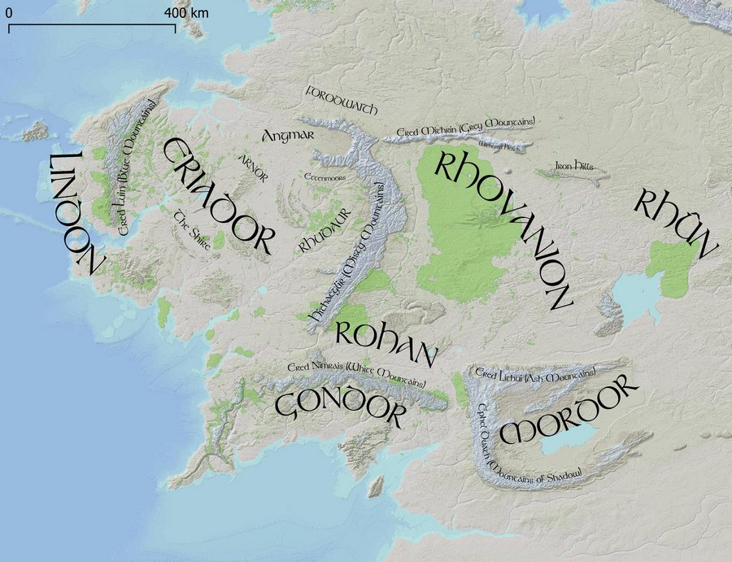
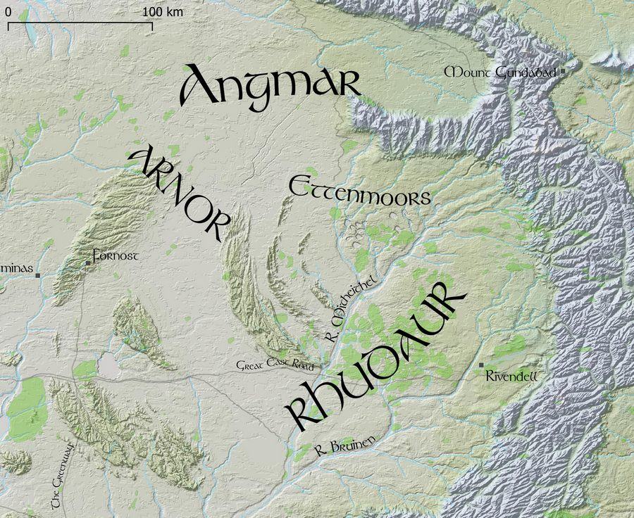
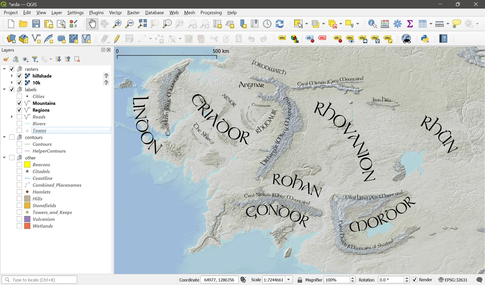
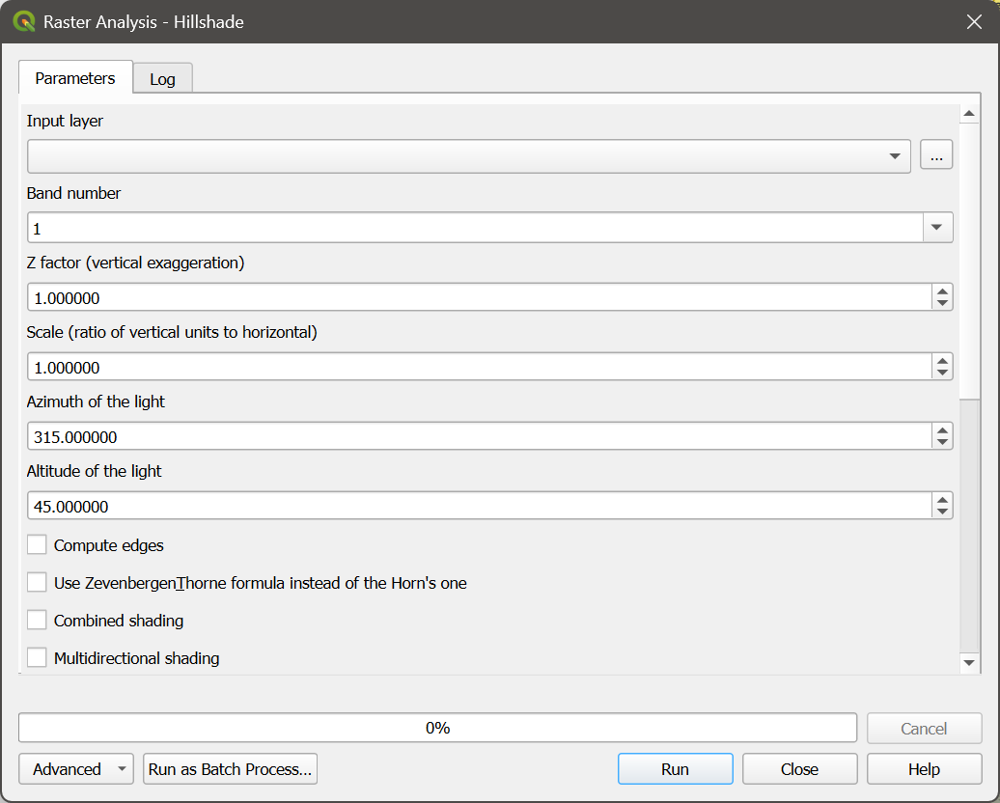

# Arda

Maps of J. R. R. Tolkien's Middle Earth, using a DEM (Digital Elevation Model), which is a 10k x 10k pixel black and white jpeg image, plus a high resolution 32k x 32k pixel 16-bit version, and place name vectors.

This project was originally created by users on the [Outerra Worlds Forum](http://worlds.outercraft.com/forum/index.php) - monks and Redrobes created the DEM using real-world 3d elevation data, hand-editing, and simulated erosion, in a project called ME-DEM; and monks, SeerBlue, and Redrobes created the place names and other vector layers, later maintained as [ME-GIS](https://github.com/jvangeld/ME-GIS). The 32k x 32k DEM comes from a separate project started by Pete Lewis ([therealJiko](https://github.com/therealJiko)), who took the ME-DEM, ran erosion simulations on it in Unreal Engine for greater detail, and generously gave the result to this project - see [issue #4](https://github.com/bburns/Arda/issues/4).

[Arda](https://en.wikipedia.org/wiki/Arda_(Tolkien)) was the name of the entire world, which included the part known as Middle Earth. 

## Goals

- Make colored elevation maps with hillshading
- Make name placement and size similar to Tolkien's maps
- Use as detailed maps for Adventures in Middle Earth (D&D 5e) games

## Data

The folder 'data' includes:

- arda.qgs - the XML project file for QGIS - it describes where to find the raster and vector layers, and how to color the map. Note: you can also use .qgz to save the project, but that is a zip file and I had wanted to use the XML version to try to conserve space in the git repo. As it is though, QGIS doesn't seem to maintain attribute order in the XML, so the text diffs can be large. 
- arda_attachments.zip - auxiliary project data stored in a sqlite database, eg for custom overrides to labels. This is a QGD file, and would be included in a .qgz file. 

- rasters
  - 10k
    - dem.jpg - black and white jpg DEM file with 10k x 10k pixels - the ME-DEM. The entire map covers 2000km on each side, so the resolution is 200m/pixel. 
    - dem.jpg.aux.xml - some metadata
    - dem.wld - defines how the DEM corresponds to the map coordinate system as used by the vector data. This is currently slightly off - improvements could be made. 
    - hillshade.jpg - the hillshade image rendered from dem.jpg.
    - hillshade.jpg.aux.xml - some metadata
  - 32k
    - dem.vrt - 16-bit DEM with 32k x 32k pixels, 62m/pixel, as a GDAL virtual raster over four quadrant files - see [High resolution DEM](#high-resolution-dem).
    - dem_nw.tif, dem_ne.tif, dem_sw.tif, dem_se.tif - (not in git) the quadrant GeoTIFFs the .vrt refers to.
    - hillshade.tif - (not in git) the hillshade image rendered from dem.vrt.
    - tiles - (not in git) the 64 source heightmap PNGs the DEM is built from - from the [dem-32k-source-v1](https://github.com/bburns/Arda/releases/tag/dem-32k-source-v1) release

- vectors
  - contours.gpkg - GeoPackage file with elevation contours
  - vectors.gpkg - GeoPackage file with layers for place names, rivers, roads, forests, mountains, cities, etc. - from [ME-GIS](https://github.com/jvangeld/ME-GIS).

## Resolution

The entire map covers 2000km on each axis, so the resolution of the 10k x 10k DEM is 200m/pixel, and the 32k x 32k DEM is 62m/pixel. 

## Font

The font is Tolkien, originally from https://fontzone.net/font-details/tolkien. 

## Installing

Clone this repo

    git clone https://github.com/bburns/Arda.git
    cd Arda

Note: if you just want to look around without making edits, you can save repo space with a shallow clone - 

    git clone --depth=1 https://github.com/bburns/Arda.git

Install the Tolkien font (fonts/Tolkien.ttf) in your system - eg in Windows, right click on the file and say Install. 

Install [QGIS](https://qgis.org/)

Open [data/arda.qgs](./data/arda.qgs) in QGIS

You can turn different layers on and off, adjust opacity, change the map colors, add labels, etc.

## Building

If you change the DEM and need to rebuild the hillshade layer - **Raster / Analysis / Hillshade** - enter a Z factor (vertical exaggeration) of 100.0 and click Run. Then adjust the global opacity of the resulting layer to 50% - **Layer Styling sidebar / Transparency / Global Opacity**. This allows the underlying colored map to show through. 

For the 32k DEM use a Z factor of 0.4 instead - its 16-bit values are roughly 250-360x larger than the 8-bit values in the 10k one. Or rebuild both the DEM and hillshade from the command line with scripts/build-dem.ps1.

## High resolution DEM

The 32k x 32k 16-bit DEM (four quadrant GeoTIFFs, ~1 GB total) and its hillshade (hillshade.tif, 197 MB) are too large for git, so they are attached to a GitHub release instead - https://github.com/bburns/Arda/releases/tag/dem-32k-v1. Download all five files into `data/rasters/32k/` (`dem.vrt`, which is in git, stitches the four quadrants into one layer), then in QGIS tick the `32k` layer group and untick `10k`. They are georeferenced to line up exactly with the 10k DEM.

Until the files are downloaded, QGIS will report the two layers as unavailable when opening the project - choose *Keep Unavailable Layers* and carry on with the 10k layers.

The heightmap was created by Pete Lewis ([therealJiko](https://github.com/therealJiko)) from the ME-DEM, with added erosion simulation - thank you! It is licensed [CC BY 4.0](https://creativecommons.org/licenses/by/4.0/) - see [License](#license). The source data is an 8x8 grid of 4033x4033 16-bit PNG heightmap tiles exported from Unreal Engine (MEDEM_x0_y0.png ... MEDEM_x7_y7.png, 766 MB), from his [LOTROW](https://github.com/therealJiko/LOTROW) repo at [TERRAIN/height_ue](https://github.com/therealJiko/LOTROW/tree/main/TERRAIN/height_ue). A copy is attached to a separate release - https://github.com/bburns/Arda/releases/tag/dem-32k-source-v1 - download medem-tiles.zip and unzip it into `data/rasters/32k/`, which puts the tiles in `data/rasters/32k/tiles/`. `scripts/build-dem.ps1` georeferences the tiles, stitches them into the quadrant GeoTIFFs and dem.vrt, adds overviews, and renders the hillshade - it needs GDAL, which comes with QGIS.

    .\scripts\build-dem.ps1 -TilesDir data\rasters\32k\tiles

## Todo

- Add river sizes in meters and render widths accordingly
- Make map views for the Hobbit (overview, The Shire, Eriador, Misty Mountains, Mirkwood)
- Make map views for The Lord of the Rings corresponding to travels
- Explain QGIS and pull requests for shapefile data in readme
- Switch easily between colorful and minimal color versions - how do?
- Render to tiles for Google Maps-like site, using Leaflet - try vector map tiles and mapboxGL? include search index

## History

Some users on the [Outerra Worlds Forum](http://worlds.outercraft.com/forum/index.php) created the original projects, called ME-DEM (the elevation map) and ME-GIS (the vector layers). 

monks and Redrobes created the DEM using real-world 3d elevation data, hand-editing, and simulated erosion. 

monks, SeerBlue, and Redrobes created the place names. 

jvangeld took over project maintenance, as [ME-GIS](https://github.com/jvangeld/ME-GIS).

bburns made the project Arda - added curved Tolkienesque labels, colored the different elevations, and added a hillshade layer.

andrewheiss took over project maintenance for the old vector layers - https://github.com/andrewheiss/ME-GIS - so these need to be merged...

tetrakai1 fixed accent characters and moved the shapefiles into geopackage files

Pete Lewis ([therealJiko](https://github.com/therealJiko)) started a separate project that needed more detail, so he ran erosion simulations on the ME-DEM in Unreal Engine to make a high resolution heightmap of Middle Earth, and gave it to Arda - see [issue #4](https://github.com/bburns/Arda/issues/4).

bburns added the 32k DEM from that heightmap (2026-09-20) - see [docs/2026-09-20-32k-dem.md](./docs/2026-09-20-32k-dem.md) for how it was built and what was learned about the data.

## License

- Code (scripts/, the QGIS project) - MIT.
- 32k heightmap (data/rasters/32k/, and the tiles in the dem-32k-source-v1 release) - [CC BY 4.0](https://creativecommons.org/licenses/by/4.0/), by Pete Lewis ([therealJiko](https://github.com/therealJiko)), with his permission - see [issue #4](https://github.com/bburns/Arda/issues/4). Credit him if you use it.
- The original ME-DEM (data/rasters/10k/) that the 32k heightmap is based on, and the ME-GIS vector layers (data/vectors/), are by the forum users listed under [History](#history) - their license is uncertain.

This is a fan work, not affiliated with the Tolkien Estate. These licenses cover the contributors' own work only, not Tolkien's world itself.
